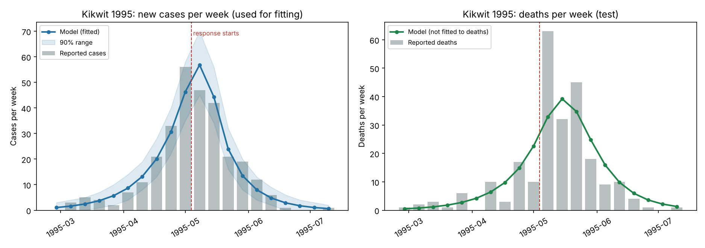
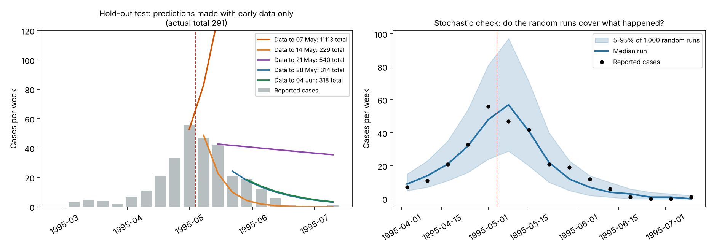
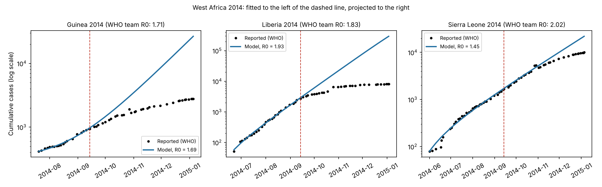
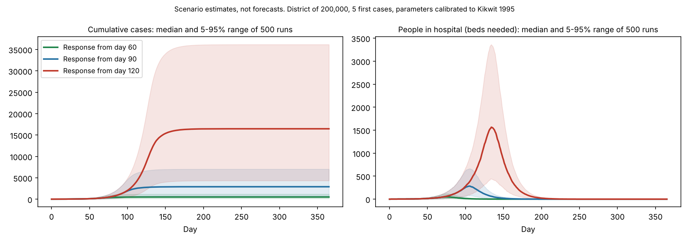

# EpiSim Ebola model: description, calibration and test results

Version 0.1.0, 16 November 2026

## 1. Summary

This is a compartmental model of Ebola with three routes of transmission (community, hospital, funeral). It has been fitted to one real outbreak and tested in five ways against real data.

| Question | Answer |
|---|---|
| Is the code correct? | Yes, as far as tested. 16 automated tests pass, including a check against a mathematical result and a check that the fitting code recovers a known answer. |
| Is it calibrated to real data? | Yes, to the Kikwit 1995 outbreak (291 dated cases). |
| Does it reproduce data it was not fitted to? | Partly. It reproduces the deaths in Kikwit (235 against 236). It recovers published R0 values for two of three West African countries. |
| Can it forecast? | **No.** Projections made part-way through an outbreak were wrong by a factor of 1.6 to 4.4 in most tests. |
| Has an epidemiologist reviewed it? | **No.** |

**What it is suitable for:** showing how response timing and strength change an outbreak, as scenario estimates with ranges.

**What it is not suitable for:** forecasting case numbers, or any real operational decision, until the review and further testing in section 9 are done.

## 2. The model

People move between six compartments.

| Compartment | Meaning |
|---|---|
| S | Susceptible |
| E | Exposed: infected, not yet infectious |
| I | Infectious, in the community |
| H | Hospitalised |
| F | Dead and not yet buried (funeral) |
| R | Removed: recovered, or buried |

```
S -> E -> I -> H -> F -> R        I -> F (dies at home)     I -> R (recovers at home)
                                  H -> F (dies in hospital) H -> R (recovers in hospital)
```

The structure follows Legrand et al. (2007). Everyone who dies passes through F. Infection comes from people in I, H and F, each with its own transmission rate:

```
new infections per day = (beta_I x I + beta_H x H + beta_F x F) x S / N
```

Each rate is the route's share of R0 divided by the average time one case spends in that setting. The three parts add back to R0 exactly (tested).

A **response** multiplies the transmission of one or more routes by a factor between 0 and 1, from a start day, optionally until an end day, and optionally building up over a number of days.

Two solvers use the same parameters:

- **Deterministic:** the average behaviour, as one smooth curve. Used for fitting.
- **Stochastic:** each movement is a random draw, repeated over many runs. Used for scenario ranges and the chance that an introduction dies out.

## 3. Data

| Outbreak | What | Source | Obtained from |
|---|---|---|---|
| Kikwit, DRC, 1995 | Daily symptom onsets (292) and deaths (236), 6 January to 16 July 1995 | Khan et al. (1999) | `outbreaks` R package, dataset `ebola_kikwit_1995` (MIT licence) |
| West Africa, 2014 | Cumulative reported cases and deaths for Guinea, Liberia and Sierra Leone, March 2014 to January 2015 | WHO Disease Outbreak News and WHO situation reports | Compilation by C. Rivers, `cmrivers/ebola` on GitHub |

Notes on the data:

- **Kikwit.** 315 cases were identified in total, and 292 have a known onset date. Before 1 March 1995, cases were not recorded daily, and the data show one case on 6 January followed by seven weeks with none. Fitting uses the 20 weeks from 27 February to 16 July (291 cases).
- **West Africa.** These are counts as reported at the time. They were revised often, sometimes downwards, and under-reporting was substantial. They are not the final case database.
- The West Africa file is a third-party transcription of WHO reports. It has not been checked line by line against the original WHO documents.

`data/SOURCES.md` gives the download addresses, licences and the processing steps.

## 4. Parameters

### Fixed from the literature

| Parameter | Value | Source |
|---|---|---|
| Incubation period | 8.5 days | Pooled estimate, systematic review (Nash et al. 2024) |
| Onset to death | 9.3 days | Same review, pooled |
| Onset to recovery | 13.0 days | Same review, pooled |
| Death to burial | 2 days | Legrand et al. (2007) |

### Fixed for Kikwit 1995

| Parameter | Value | Source |
|---|---|---|
| Population | 200,000 | Kikwit area, Legrand et al. (2007) |
| Onset to admission | 5 days | Legrand et al. (2007) |
| Share hospitalised | 80% | Legrand et al. (2007) |
| Case fatality | 81% | Khan et al. (1999), via Legrand et al. (2007) |
| Route shares of R0 | 18.5% community, 14.8% hospital, 66.7% funeral | Legrand's central estimates (0.5, 0.4 and 1.8 of 2.7). Their confidence intervals are very wide |
| First interventions | 4 May 1995 (day 118) | Legrand et al. (2007) |
| Share of cases in the data | 92.7% (292 of 315) | Khan et al. (1999) |

### Fitted to the Kikwit data

| Parameter | Estimate | 95% range |
|---|---|---|
| R0 | **2.63** | 2.33 to 3.01 |
| Share of transmission remaining after the response | 5.5% | 2.4% to 9.2% |
| R after the response | **0.15** | 0.06 to 0.24 |
| Days for the response to reach full effect | 14 | chosen from 0, 7, 14, 21 |
| Infectious people on 6 January (see below) | 0.08 | |

**The starting value of 0.08 is not a real number of people.** The first case fell ill on 6 January, but sustained spread began weeks later. A deterministic model cannot represent that chance delay, so the fit uses a fraction of a case to shift the start. Fixing it at one case gives a lower R0 (1.91) and a worse fit.

### Not identifiable from this data

Case counts over time cannot separate the three routes. The route shares, the share hospitalised and the split of the response between routes are **assumptions**, and they matter for any scenario about safe burials or hospital infection control.

## 5. Calibration method

1. The deterministic solver gives expected new cases per week, multiplied by the share of cases in the data.
2. Observed weekly counts are assumed to scatter around the expectation with a negative binomial distribution.
3. The parameters that make the observed counts most likely are found by numerical search from several starting points (maximum likelihood).
4. The 95% ranges are profile-likelihood intervals: for each trial value of a parameter, the others are re-fitted.

Result: the model gives 291.1 cases over the 20 weeks against 291 observed, with an average error of 2.8 cases per week. All 20 weekly counts fall inside the model's 90% range.



## 6. How sure is R0?

The 95% range above assumes the fixed values are right. Changing them moves the estimate more than the range suggests.

| Assumption changed | R0 | R after response |
|---|---|---|
| Main calibration | 2.63 | 0.15 |
| Response takes effect at once | 3.21 | 0.26 |
| Response builds up over 7 days | 2.94 | 0.23 |
| Response builds up over 21 days | 2.42 | 0.06 |
| Start fixed at 1 case on 6 January | 1.91 | 0.11 |
| Response dated 9 May | 2.54 | 0.14 |
| Route shares 55 / 15 / 30 | 2.33 | 0.17 |
| All transmission in the community | 2.05 | 0.20 |
| Survivors infectious for 10 days | 2.57 | 0.15 |
| Incubation 6 days | 2.41 | 0.25 |
| Incubation 11 days | 2.84 | 0.04 |

**R0 lies between 1.9 and 3.2 across these cases.** Published estimates for the same outbreak are 2.7 (1.9 to 2.8) in Legrand et al. (2007) and 1.83 in Chowell et al. (2004). Our range covers both.

R after the response is below 1 in every case, between 0.04 and 0.26. Legrand et al. estimated 0.4 (0.3 to 0.6), which is higher than ours.

## 7. Tests against real data

### Test 1. Deaths in Kikwit (not used in fitting): passed

| | Observed | Model |
|---|---|---|
| Deaths over the 20 weeks | 236 | 235 |
| Week with most deaths | week of 8 May | week of 15 May |
| Correlation of weekly counts | | 0.86 |

The total matches closely, in part because the 81% fatality was taken from this outbreak. The timing is the real test: the model's deaths follow the observed pattern, and peak one week late. Observed weekly deaths are irregular (63 in one week, 32 the next).

### Test 2. Random runs against what happened: passed

1,000 stochastic runs were started from the model's state on 3 April 1995. All 15 observed weekly counts fall inside the 5 to 95% range. Total cases from that date: 277 observed, against a simulated median of 274 (154 to 443).

This uses the same data as the fit, so it shows the stochastic solver is consistent with the calibration. It is not independent evidence.

### Test 3. Predicting the rest of the outbreak from early data: failed

The model was fitted to the first weeks only and asked to predict the remainder.

| Data used up to | Days after response began | Predicted further cases | Observed further cases |
|---|---|---|---|
| 7 May | 3 | 10,971 | 149 |
| 14 May | 10 | 40 | 102 |
| 21 May | 17 | 309 | 60 |
| 28 May | 24 | 62 | 39 |
| 4 June | 31 | 47 | 20 |



Before the response shows in the data, the model has no way of knowing how well it will work, and it predicts continued growth. For three weeks after, the predictions swing between too low and too high. From 24 days on they are stable and too high by a factor of 1.6 to 2.3.

**The model cannot predict the effect of a response before that effect is visible in the data.**

### Test 4. R0 for West Africa 2014: passed for two countries of three

The model was fitted to WHO-reported cumulative cases up to 14 September 2014, the cut-off used by the WHO Ebola Response Team (2014).

| Country | Our R0 | WHO team R0 |
|---|---|---|
| Guinea | 1.69 | 1.71 |
| Liberia | 1.93 | 1.83 |
| Sierra Leone | 1.45 | 2.02 |

The estimate depends on the weeks chosen:

| Country | Whole window | Early part only | Later part only |
|---|---|---|---|
| Guinea | 1.69 | 1.26 | 1.96 |
| Liberia | 1.93 | 1.82 | 1.91 |
| Sierra Leone | 1.45 | 2.48 | 1.50 |

Liberia is stable. Sierra Leone's growth slowed during the window, so its early weeks give 2.48 and the whole window 1.45, with the WHO value in between. The windows were chosen by inspection, which is a weakness. The WHO team used dates of symptom onset from the case database, which are better data than cumulative reports.

The model's average time between successive cases is 17.1 days. The pooled serial interval in the systematic review is 15.4 days (13.2 to 17.5), so the model sits at the upper end.

### Test 5. Projecting West Africa forward with no change: failed

| Country | 4 weeks ahead: model / reported | 8 weeks ahead: model / reported |
|---|---|---|
| Guinea | 1,960 / 1,472 | 4,426 / 1,878 |
| Liberia | 10,020 / 4,262 | 29,971 / 6,822 |
| Sierra Leone | 3,281 / 3,252 | 6,177 / 5,368 |



Sierra Leone is close. Guinea is too high by a factor of 1.3 and then 2.4, and Liberia by 2.4 and then 4.4. Growth slowed in reality as the response and behaviour changed, and a model with constant transmission cannot anticipate that.

## 8. What the tests mean

- **The mechanics are right.** The model reproduces the shape, size and deaths of a real outbreak once its parameters are fitted, and recovers published R0 values where the data are stable.
- **R0 is uncertain.** Even for one well-studied outbreak, reasonable choices give 1.9 to 3.2.
- **It is not a forecasting tool.** Tests 3 and 5 show errors of 1.6 to 4.4 times.
- **Its proper use is comparison.** "What changes if the response starts 30 days later?" is a question it can illustrate, under stated assumptions.

## 9. Limits and what is still needed

1. **No epidemiologist has reviewed** the structure, the fixed values or the conclusions.
2. **Calibrated to one outbreak.** Kikwit was hospital-centred, 30 years ago, in a different country. Nothing here is specific to Rwanda.
3. **Route shares are assumed.** Results about safe burials or hospital measures depend on them.
4. **The response is one number** applied to all routes. What each real measure contributes is not estimated.
5. **Everyone mixes evenly.** No households, districts, health workers or superspreading. Real Ebola spreads unevenly, so the model understates how often introductions die out.
6. **Time in each compartment is exponential**, which is cruder than real delay distributions.
7. **The ranges cover chance only**, not uncertainty in the parameters.
8. **The West Africa data are a third-party transcription** of provisional reports.
9. **Populations for the West African countries are approximate.** Early growth does not depend on them.
10. **Marburg has not been calibrated or tested at all.**

Next steps, in order: review by an epidemiologist; calibration to a second and third outbreak, including a WHO case database if access is granted; add overdispersion; estimate uncertainty across parameters; test on Marburg.

## 10. Use in the EpiSim demo

Suggested wording on screen: *"Model calibrated to the Kikwit 1995 outbreak. Scenario estimates, not forecasts. Not yet reviewed by an epidemiologist."*

Example from `scripts/demo_scenarios.py`: a district of 200,000 people, 5 first cases, the calibrated parameters, and the response seen in Kikwit started on different days (500 runs each).

| Scenario | Cases, median (5 to 95%) | Deaths, median | Peak in hospital, median (5 to 95%) |
|---|---|---|---|
| Response from day 60 | 500 (142 to 1,188) | 404 | 53 (15 to 125) |
| Response from day 90 | 2,904 (728 to 7,022) | 2,362 | 289 (78 to 672) |
| Response from day 120 | 16,456 (4,329 to 36,158) | 13,317 | 1,574 (446 to 3,386) |



These numbers assume the calibrated R0 of 2.63 and a response as strong as Kikwit's. They show how much timing matters in the model. They are not estimates for any real district.

The same calculation for Kikwit itself (deterministic): the response as it happened gives 317 cases (315 were recorded). Two weeks later gives 734, and four weeks later 1,695.

## 11. Reproducing these results

```
pip install numpy scipy pandas matplotlib pytest
python3 -m pytest tests -q               # 16 tests, a few seconds
python3 scripts/run_calibration.py       # about 5 minutes; rewrites results/ and calibrated/
python3 scripts/west_africa_window_check.py
python3 scripts/demo_scenarios.py
```

Random seeds are fixed, so the numbers come out the same on every run. Every figure quoted here is in `results/results.json`.

## 12. References

1. Khan AS, et al. The reemergence of Ebola hemorrhagic fever, Democratic Republic of the Congo, 1995. *Journal of Infectious Diseases* 1999; 179 (Suppl 1): S76-S86.
2. Legrand J, Grais RF, Boelle PY, Valleron AJ, Flahault A. Understanding the dynamics of Ebola epidemics. *Epidemiology and Infection* 2007; 135(4): 610-621. doi:10.1017/S0950268806007217. https://www.cambridge.org/core/product/BAEEC049DE2893FA58DD8F38E19F62D8/core-reader
3. Chowell G, Hengartner NW, Castillo-Chavez C, Fenimore PW, Hyman JM. The basic reproductive number of Ebola and the effects of public health measures: the cases of Congo and Uganda. *Journal of Theoretical Biology* 2004. https://arxiv.org/abs/q-bio/0503006
4. WHO Ebola Response Team. Ebola virus disease in West Africa: the first 9 months of the epidemic and forward projections. *New England Journal of Medicine* 2014. https://research-information.bris.ac.uk/en/publications/ebola-virus-disease-in-west-africa-the-first-9-months-of-the-epid/
5. Nash RK, et al. Ebola virus disease mathematical models and epidemiological parameters: a systematic review. Preprint, medRxiv 2024.03.20.24304571; later published in *Lancet Infectious Diseases*. https://medrxiv.org/content/medrxiv/early/2024/03/20/2024.03.20.24304571.full.pdf
6. World Health Organization. Ebola disease fact sheet, 24 April 2025. https://who.int/news-room/fact-sheets/detail/ebola-disease
7. Kikwit data: `ebola_kikwit_1995` in the `outbreaks` R package, R Epidemics Consortium. https://github.com/reconhub/outbreaks
8. West Africa data: Rivers C. Data for the 2014 global Ebola outbreak, compiled from WHO Disease Outbreak News and situation reports. https://github.com/cmrivers/ebola

Citation details to confirm before publishing: the values quoted from references 3, 4 and 5 were read from abstracts or the preprint. The author list and journal details of reference 5, and the volume and page numbers of references 3 and 4, should be checked against the published versions.
